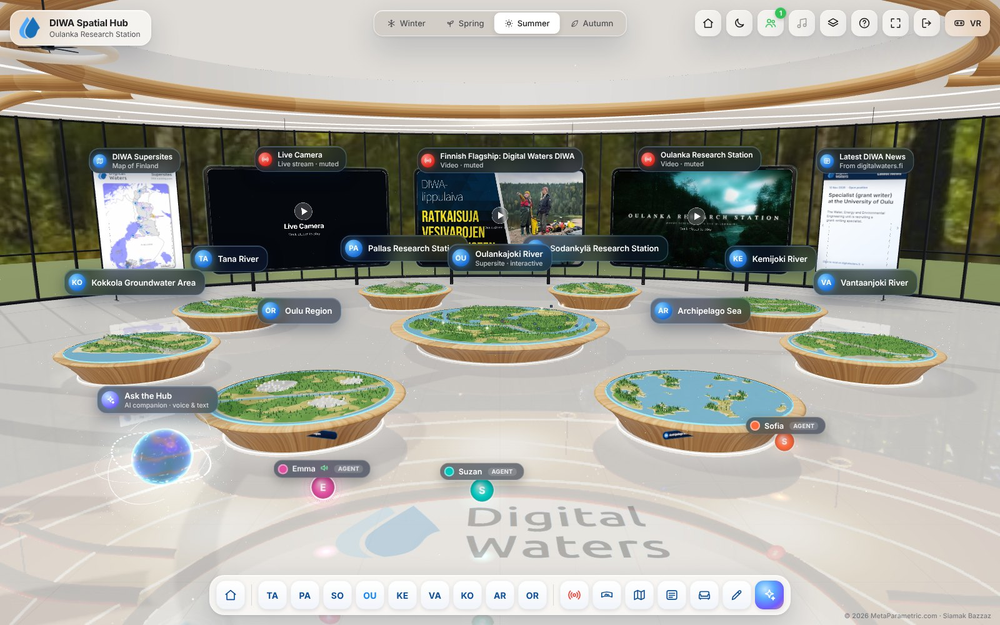

# DIWA Spatial Hub

**An immersive digital twin of the Digital Waters (DIWA) supersites, running directly in the web browser.**

### ▶ [Open the hub](https://siamakab.github.io/diwa-spatial-hub/)

The DIWA Spatial Hub brings environmental monitoring sites across Finland together in one virtual hall. Each site is a miniature 3D landscape on its own table. Visitors can walk between the tables, explore sensor stations, follow data through the seasons, step into 360° views of the field sites and meet each other in the same space. The hub runs in any modern browser and on VR headsets, with nothing to install.

## Sites

Tana River (TA) · Pallas Research Station (PA) · Sodankylä Research Station (SO) · **Oulankajoki River (OU)** · Kemijoki River (KE) · Vantaanjoki River (VA) · Kokkola Groundwater Area (KO) · Archipelago Sea (AR) · Oulu Region (OR)

The **Oulankajoki** supersite at Oulanka Research Station, Kuusamo, is the large centre table and the first fully interactive one.

## Features

- **Sensor stations:** stations from the Oulanka snow and reindeer-grazing experiment, with their sensors, measured variables, measurement heights and data-quality information.
- **Time series and playback:** weather and hydrology charts linked to a timeline that can be played through the year.
- **Seasons:** winter, spring, summer and autumn, shown on the landscapes and the surroundings.
- **Scenarios:** spring flood scenarios of different return periods, and river-ice scenarios that include ice growth, breakup and ice jams.
- **Spatial context:** the river network, the catchment boundary and land-cover layers.
- **360° field views:** 15 panoramas from around Oulanka Research Station and the Oulankajoki valley. The landscape outside the hall is a real 360° photo from the Oulankajoki riverside.
- **Media wall:** three large video screens that play when you walk up to them, framed by a supersite map of Finland with pulsing points and a slideshow of the latest news from digitalwaters.fi.
- **AI companion:** a floating orb you can talk to by voice or text. It knows the hall, including the tables, sensors, screens, boards and where you are standing, and answers aloud.
- **Meet together:** every visitor enters with their name and appears to the others as a glowing circle avatar in a colour chosen by the system. The circle shows a live voice waveform while someone talks, with spatial voice once a visitor turns on their microphone.
- **Resident agents:** Emma, Suzan and Sofia live in the hall. Emma greets each visitor and gives guided tours, and each agent hosts three supersite tables. Tap an agent, or ask the orb ("show me the spring flood"), and she walks there and shows it: floods, river ice, winter, the northern lights, a 360° photo, the video wall or the map.
- **Lounges and whiteboards:** four seating corners with DIWA brochures, each with a shared whiteboard for drawing, writing and erasing together.
- **Living sky:** optional clouds drift over the tables, with rain or snow falling at a wind-blown angle, all following the weather of the selected day.
- **Day and night:** switch between daylight and a night mode with northern lights and twinkling stars over the forest and warm lamps inside, while the tables stay clearly lit.
- **Showcase mode:** when nobody touches the controls for 10 seconds, the view returns to the overview and circles slowly around the hall.
- **AR booklet:** a printed booklet whose table images come to life on phones through the AR viewer at /ar.
- **VR edition:** a dedicated version for Meta Quest 3 and other WebXR headsets ([open in the headset](https://siamakab.github.io/diwa-spatial-hub/vr.html)), with laser pointers, thumbstick walking, snap turning and rising for a view from above, teleporting, raised viewpoints over each table, a menu on your hand, 3D info cards and 360° photos you can step inside.

## How to explore

| Action | Control |
|---|---|
| Enter | Type your name on the start screen and press *Enter the hub* |
| Visit a site | Click a table, its label or a dock icon (or press keys 1–9) |
| Look around | Drag |
| Zoom | Scroll |
| Walk | W A S D |
| Back to the overview | H |
| Talk to the assistant | Hold Space, or tap the orb |
| Guided tour | Tap Emma, Suzan or Sofia, or ask the orb "give me a tour" |
| See who is here | People button; *Unmute* to talk, *Copy invite link* to invite others |
| Sit in a lounge | Sofa icon in the dock, then click a seat |
| Whiteboard | Pen icon in the dock, then drag on the board |
| Day / night | Moon / sun button |
| Leave | Exit button at the top right: leaves the room and returns to the start screen |
| VR (Meta Quest 3) | Open the VR edition in the Quest Browser and press *Enter in VR*. Point and pull the trigger to select or teleport, walk with the left stick; push the right stick left or right to turn and forward or back to rise or sink; use the menu on your left hand (X hides it) |

Chrome or Edge on a laptop or desktop gives the best experience.

## About the data

This is a research demonstrator. The sensor metadata is taken from the DIWA metadata template for the Oulanka experiment. The terrain, station positions, time series and scenarios are demonstration data, and they are labelled that way in the interface. They will be replaced step by step with measured data, national elevation models and official spatial datasets.

## Author

**Dr. Siamak Bazzaz**, Spatial Computing Architect and Researcher
Water, Energy and Environmental Engineering, Faculty of Technology, University of Oulu
Digital Waters (DIWA) Flagship

[LinkedIn](https://www.linkedin.com/in/siamakbazzaz/) · [University of Oulu profile](https://www.oulu.fi/en/researchers/siamak-bazzaz)

## Credits

- **360° photography:** Siamak Bazzaz, Oulanka, September 2026.
- **Built with:** [three.js](https://threejs.org), [Trystero](https://github.com/dmotz/trystero) for peer-to-peer sessions, Cloudflare Workers AI for the assistant, and the Web Audio, WebRTC, Web Speech and WebXR browser APIs.
- **Music:** composed live in the browser for this project.

© 2026 MetaParametric.com · Siamak Bazzaz
