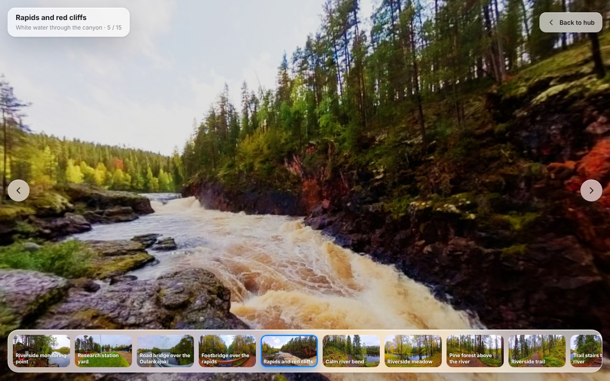

# DIWA Spatial Hub

**An immersive digital twin of the Digital Waters (DIWA) supersites, running directly in the web browser.**

### ▶ [Open the hub](https://siamakab.github.io/diwa-spatial-hub/)

The DIWA Spatial Hub brings environmental monitoring sites across Finland together in one virtual hall. Each site is a miniature 3D landscape on its own table. Visitors can walk between the tables, explore sensor stations, follow data through the seasons and step into 360° views of the field sites. The hub runs in any modern browser and on VR headsets, with nothing to install.

## Sites

Tana River · Pallas Research Station · Sodankylä Research Station · **Oulankajoki River** · Kemijoki River · Vantaanjoki River · Kokkola Groundwater Area · Archipelago Sea · Organic Space Planning

The **Oulankajoki** supersite at Oulanka Research Station, Kuusamo, is the first fully interactive table.

## Features

- **Sensor stations:** stations from the Oulanka snow and reindeer-grazing experiment, with their sensors, measured variables, measurement heights and data-quality information.
- **Time series and playback:** weather and hydrology charts linked to a timeline that can be played through the year.
- **Seasons:** winter, spring, summer and autumn, shown on the landscapes and the surroundings.
- **Scenarios:** spring flood scenarios of different return periods, and river-ice scenarios that include ice growth, breakup and ice jams.
- **Spatial context:** the river network, the catchment boundary and land-cover layers.
- **360° field views:** 15 panoramas from around Oulanka Research Station and the Oulankajoki valley.
- **Live camera:** a live video stream shown inside the hall.
- **AI companion:** an assistant you can talk to by voice or text, answering in a natural voice.
- **Meet together:** several visitors can share the hall at the same time. Each person appears as a glowing circle avatar in their own colour with their name above it. The circle shows a live voice waveform while they talk, and you can talk by spatial voice, gather around a table or sit together in the lounge.
- **Living sky:** clouds drift over the tables, and rain or snow falls from them at a wind-blown angle. All of it follows the cloud cover, precipitation and temperature of the selected day.
- **Day and night:** switch the hall between daylight and a night mode, with the tables kept clearly lit.
- **VR:** works with WebXR headsets such as Meta Quest 3 through the headset's web browser.

## How to explore

| Action | Control |
|---|---|
| Visit a site | Click a table, its label or a dock icon (or press keys 1–9) |
| Look around | Drag |
| Zoom | Scroll |
| Walk | W A S D |
| Back to the overview | H |
| Talk to the assistant | Hold Space, or tap the orb |
| Meet others | People button → enter your name → Join, then share the invite link |
| Sit in the lounge | Sofa icon in the dock, then click a seat |
| Day / night | Moon / sun button |
| VR | *Enter VR* in the headset browser, then point and pull the trigger to teleport |

Chrome or Edge on a laptop or desktop gives the best experience.

## About the data

This is a research demonstrator. The sensor metadata is taken from the DIWA metadata template for the Oulanka experiment. The terrain, station positions, time series and scenarios are demonstration data, and they are labelled that way in the interface. They will be replaced step by step with measured data, national elevation models and official spatial datasets.

## Author

**Dr. Siamak Bazzaz**, Spatial Computing Architect and Researcher
Water, Energy and Environmental Engineering, Faculty of Technology, University of Oulu
Digital Waters (DIWA) Flagship

[University of Oulu profile](https://www.oulu.fi/en/researchers/siamak-bazzaz) · [ORCID](https://orcid.org/0000-0003-2489-1285) · [Google Scholar](https://scholar.google.com/citations?user=m8JtKCYAAAAJ)

## Credits

- **360° photography:** Siamak Bazzaz, Oulanka, September 2026.
- **Built with:** [three.js](https://threejs.org), [Trystero](https://github.com/dmotz/trystero) for peer-to-peer sessions, and the Web Audio, WebRTC and WebXR browser APIs.
- **Music:** composed live in the browser for this project.
